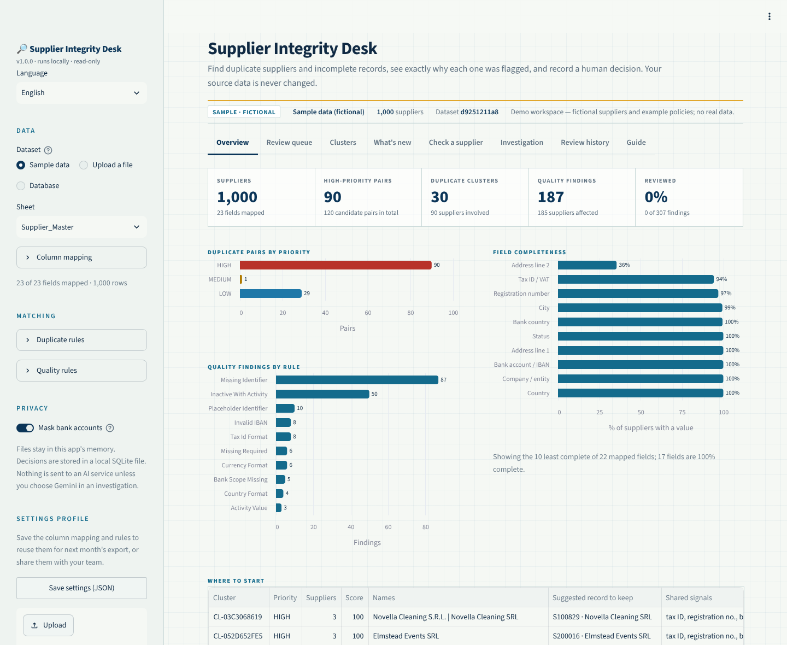
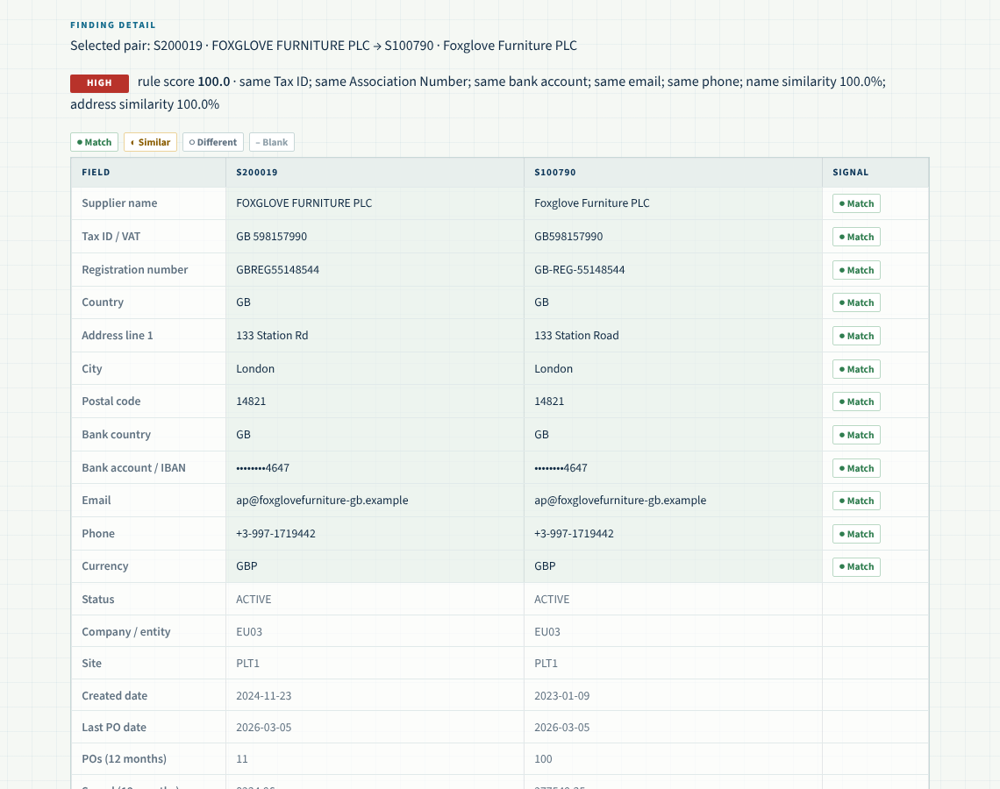
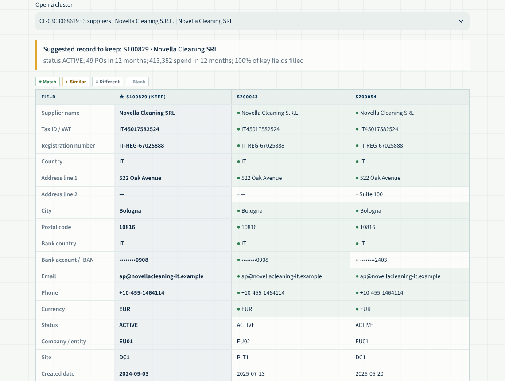
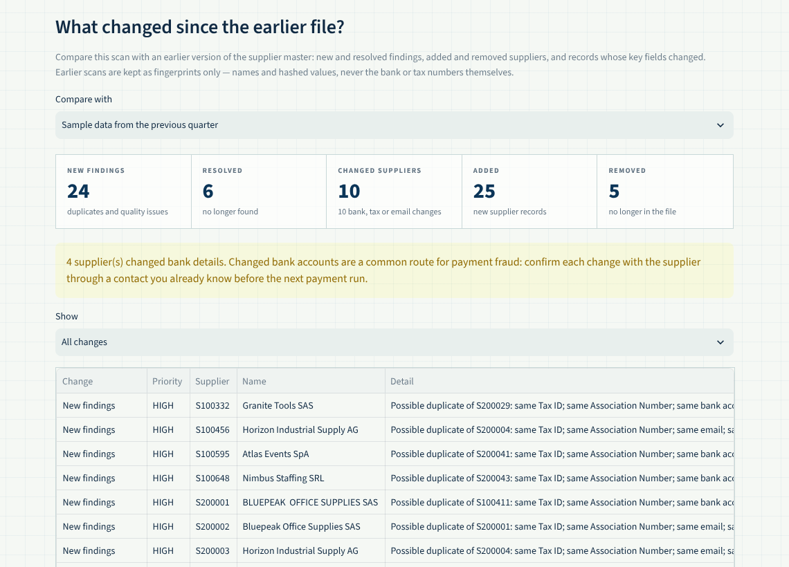
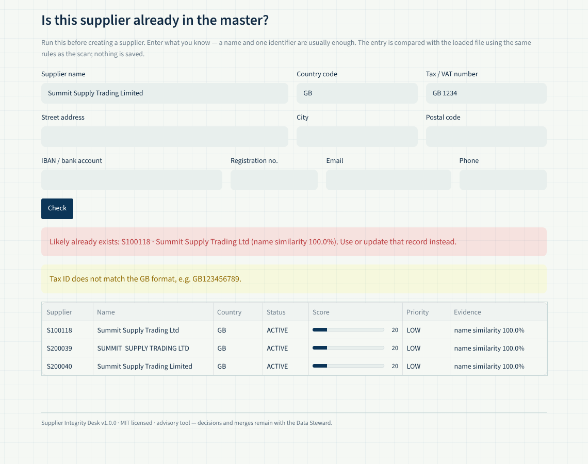
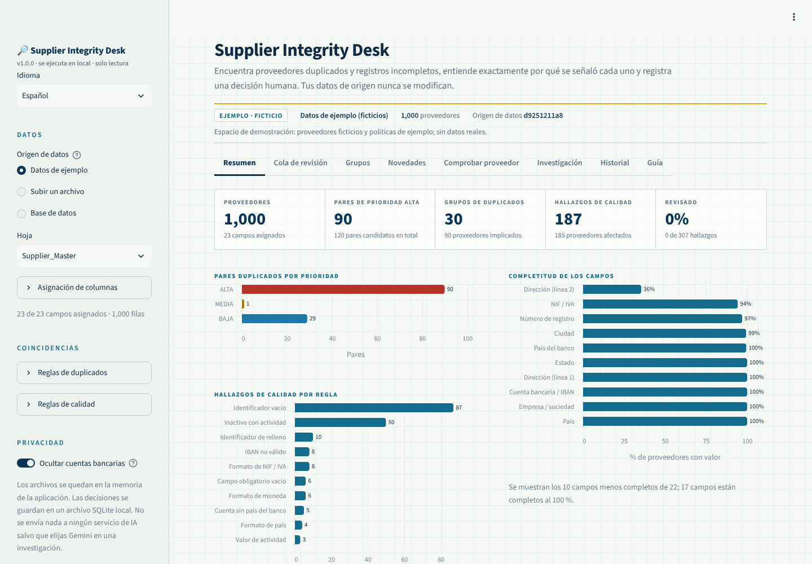
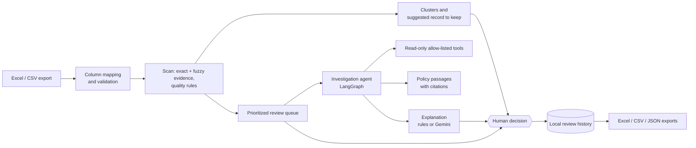
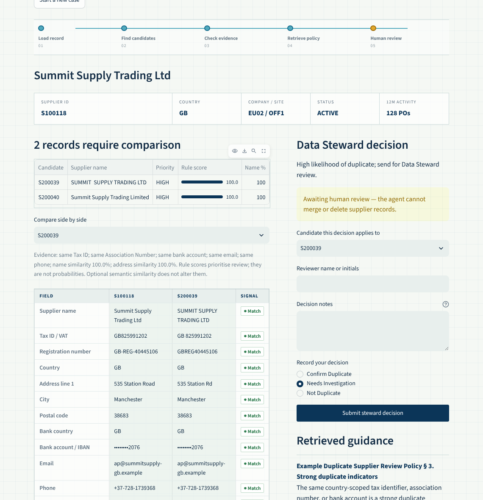

# Supplier Integrity Desk

**Find duplicate suppliers and incomplete vendor records — and see exactly why each one was flagged.**

[](https://github.com/ImadC9/supplier-integrity-desk/actions/workflows/ci.yml)

[](LICENSE)

Duplicate suppliers cause duplicate payments, split spend and fraud risk. Supplier Integrity Desk
scans a supplier master export from **any ERP** (SAP, Oracle, Dynamics, NetSuite, a spreadsheet…), finds
likely duplicates and data-quality problems with **transparent rules**, groups them into clusters,
suggests which record to keep, and lets a Data Steward record a decision. An optional
**AI investigation agent** (LangGraph) gathers evidence, cites policy and then **stops for a human** —
it can never merge, change or delete a record.

Runs locally, in English or Spanish. No API key needed. Your data is never modified.



## Features

| | |
|---|---|
| **Any export, no reformatting** | Excel or CSV/TSV, or a read-only SQL query against your database (SQLite built in; PostgreSQL, SQL Server, MySQL, Oracle… through SQLAlchemy). Columns such as `Vendor No`, `LIFNR`, `VAT Number`, `IBAN` are mapped automatically; fix the mapping in the sidebar if needed. Only supplier ID and name are required. |
| **Explainable duplicate detection** | Same tax ID or registration number (within a country), bank account, email or phone, plus fuzzy name and address similarity. Every finding lists its evidence and a rule score. Placeholders like `N/A`, `0000` or `noemail@` are ignored. |
| **What's new since last scan** | Compare this month's file with an earlier one: new and resolved findings, added and removed suppliers, and changed bank, tax or contact details (a common payment-fraud route). Decisions made on the earlier file are shown next to each finding. |
| **Check a supplier before creating it** | Type a name and any identifier to see whether the supplier already exists, and whether its tax ID and IBAN are valid. Also on the command line, for scripts and approval flows. |
| **Duplicate clusters** | A ~ B and B ~ C become one cluster, with a suggested record to keep (active, most orders and spend, most complete) and one decision for the whole cluster. |
| **Side-by-side comparison** | Field-by-field match / similar / different signals. Bank accounts are masked by default. Legal forms from 40+ countries (Ltd, GmbH, SAS, Sp. z o.o., Pty Ltd, SA de CV…) are ignored when comparing names. |
| **Data-quality rules** | Tax / VAT number format and check digits for 41 countries, invalid IBANs (length and check digits), missing required fields, placeholder IDs, malformed country and currency codes, bank accounts without a bank country, invalid activity values, inactive suppliers with recent orders. |
| **Review workflow** | Prioritized queue with filters and search, decisions with reviewer and notes, append-only local history. |
| **Action plan** | Confirmed duplicates become a keep / block list your ERP team can load into a mass change — the tool itself never edits data. |
| **Reports** | Formatted Excel report (summary, clusters, pairs, quality findings, completeness, decisions, action plan) and CSV exports. |
| **Reusable settings** | Save the column mapping and rules as a JSON profile and load it next month or share it with your team. |
| **AI investigation (optional)** | A LangGraph agent with allow-listed read-only tools, LlamaIndex policy retrieval with citations, optional local embeddings and optional Gemini explanations. Tax IDs and bank details are never sent to an AI. |
| **Tunable** | Priority thresholds, similarity cut-offs, required fields and quality checks are adjustable in the app or on the command line. |
| **English and Spanish** | The interface follows the browser language (or `?lang=es` / `SUPPLIER_DESK_LANG`), with a switch in the sidebar. Contributions of more languages are welcome. |

<table>
<tr>
<td width="50%"><br><sub>Side-by-side comparison of a flagged pair</sub></td>
<td width="50%"><br><sub>A duplicate cluster with the suggested record to keep</sub></td>
</tr>
<tr>
<td width="50%"><br><sub>What's new since last quarter's file, with bank-detail changes flagged</sub></td>
<td width="50%"><br><sub>Checking a supplier before it is created</sub></td>
</tr>
<tr>
<td colspan="2"><br><sub>The same app in Spanish</sub></td>
</tr>
</table>

## Quick start

Requires Python 3.11+.

```bash
git clone https://github.com/ImadC9/supplier-integrity-desk
cd supplier-integrity-desk
python -m venv .venv
source .venv/bin/activate          # Windows: .venv\Scripts\activate
pip install -e ".[all]"            # or: pip install -e .   (without Gemini, embeddings and SQLAlchemy)
supplier-desk app
```

The app opens at <http://localhost:8501> with **1,000 fictional suppliers** from 19 countries that contain
planted duplicates, tricky look-alikes that are *not* duplicates, and data issues. Choose **Upload a file** or **Database** in the sidebar to use your own data.

**Docker:** `docker compose up --build`, then open <http://localhost:8501>.

## Use your own data

1. Export your supplier/vendor master to Excel or CSV — any column names.
2. Upload it, check the **Column mapping** in the sidebar, and start reviewing.
3. Download the Excel report from **Overview** to share findings with data owners.
4. Record decisions, then download the **action plan** from **Review history** for the team that maintains the ERP.
5. Use **Save settings** in the sidebar so the next export maps and scans the same way.
6. Next month, open **What's new** to see only what changed since the earlier file.

To read straight from a database, choose **Database**, enter a SQLite file or a SQLAlchemy URL
(for example `postgresql://reader@erp-db/erp`) and one `SELECT` that returns the supplier table. Only a
single read-only query is accepted; use a read-only database account anyway.

See [docs/DATA_FORMAT.md](docs/DATA_FORMAT.md) for recognised columns, the scoring table and every
quality rule. Use approved or anonymized data, and see [SECURITY.md](SECURITY.md) for what is stored.

## Command line

```bash
supplier-desk scan vendors.csv --report findings.xlsx --clusters clusters.csv
supplier-desk scan vendors.xlsx --sheet "Vendors" --high 70 --ignore-country
supplier-desk scan vendors_october.csv --compare vendors_september.csv --changes changes.csv
supplier-desk scan --db "postgresql://reader@erp-db/erp" --query "SELECT * FROM vendor_master"
supplier-desk check vendors.csv --name "Acme Trading Ltd" --country GB --tax-id GB123456789 --fail-on-match
supplier-desk investigate --input vendors.xlsx --supplier-id S100118 --decision NEEDS_INVESTIGATION
supplier-desk evaluate --input sample_suppliers.xlsx      # needs a Ground_Truth sheet
supplier-desk sample                                      # copy the fictional sample workbook
supplier-desk template                                    # blank input template
```

`scan` and `check` print JSON, so they fit into scheduled jobs and supplier-onboarding scripts
(`check --fail-on-match` exits with code 3 when the supplier probably exists). Or from Python:

```python
from supplier_agent import load_supplier_master, scan_suppliers

result = scan_suppliers(load_supplier_master("vendors.csv"))
print(result.clusters[["CLUSTER_ID", "SIZE", "SURVIVOR_ID", "SIGNALS"]])
```

## How it works



| Signal | Points |
|---|---:|
| Same tax ID (same country) | 25 |
| Same registration number (same country) | 20 |
| Same bank account (same bank country) | 20 |
| Same email address | 10 |
| Same phone number | 10 |
| Name similarity ≥ 70 % | up to 20 |
| Address similarity ≥ 70 % | up to 15 |

**High** priority from 65, **Medium** from 40 (both adjustable). The score orders the work; it is not
a probability and not proof that two records are the same company.

The scan is plain Python and makes no network calls. The investigation agent runs fixed stages —
load record → find candidates → check evidence → retrieve policy → explain — and then pauses at a
human checkpoint. The explanation step cannot change scores or decide. See
[docs/ARCHITECTURE.md](docs/ARCHITECTURE.md) for the modules and extension points.



## Configuration

| Variable | Purpose |
|---|---|
| `GEMINI_API_KEY`, `GEMINI_MODEL` | Enable AI explanations in the Investigation view (optional). |
| `SUPPLIER_REVIEW_DB` | Location of the review history (default `./outputs/reviews.sqlite3`). |
| `SUPPLIER_DESK_POLICY_DIR` | Folder of Markdown policies that replaces the bundled fictional ones. |
| `SUPPLIER_DESK_MODEL_CACHE` | Cache folder for the optional embedding model. |
| `SUPPLIER_DESK_DB_URL` | Default database connection for the app and `--db` (keeps passwords out of the command line). |
| `SUPPLIER_DESK_LANG` | Interface language (`en` or `es`); otherwise the browser language is used. |

Deployment options (local, Docker, Streamlit Community Cloud, inside a company) are in
[docs/DEPLOYMENT.md](docs/DEPLOYMENT.md).

## Accuracy and limits

On the bundled sample the detector finds all 90 planted duplicate pairs with no false positives at the
default threshold, while the planted look-alikes (sister companies at one address, shared factoring
accounts) stay at low priority — see [docs/EVALUATION.md](docs/EVALUATION.md). Real data is messier, so
tune thresholds on your own data; `supplier-desk evaluate` measures precision and recall
against your own labels.

- Advisory tool: it never merges or edits records. Make changes in your ERP.
- No authentication or tamper-proof audit; reviewer names are self-reported. Run it locally or
  behind your organisation's access control.
- Up to 20,000 suppliers per file. Fuzzy comparison runs within each country, so time grows with
  the size of the largest country.
- Tax ID and IBAN checks confirm the format and check digits, not that the number is registered to
  this supplier (use VIES, HMRC or your local registry for that). Format checks do not verify official
  country or currency lists; a missing identifier is not a universal compliance failure.
- The bundled policy documents are fictional examples; replace them with your own (`SUPPLIER_DESK_POLICY_DIR`).

## Project layout

```text
supplier_agent/
  app.py            Streamlit interface (presentation only)
  cli.py            supplier-desk command
  columns.py        ERP column synonyms and mapping
  io.py             Excel/CSV loading and validation
  normalize.py      Name, address and identifier normalization
  validators.py     IBAN length and check-digit validation
  taxid.py          Tax / VAT number formats and check digits for 41 countries
  detector.py       Candidate search and rule scoring
  quality.py        Data-quality rules
  clusters.py       Duplicate clusters and record-to-keep suggestion
  triage.py         Scan → prioritized review queue
  compare.py        Field-by-field comparison
  reports.py        Excel report
  actions.py        Keep / block action plan from confirmed duplicates
  changes.py        What changed since an earlier scan (snapshots without raw identifiers)
  lookup.py         Check a new supplier against the master before creating it
  database.py       Read-only SQL source (SQLite built in, others via SQLAlchemy)
  i18n.py, i18n_es.py  Interface translations
  review_store.py   Append-only SQLite decision history
  data_tools.py     Allow-listed read-only tools for the agent
  policy_rag.py     LlamaIndex policy retrieval
  semantic.py       Optional local embeddings
  workflow/         LangGraph state, nodes, graph and analysis providers
  evaluation.py     Labelled evaluation (only module that reads Ground_Truth)
  resources/        Sample workbook (current and previous quarter), SQLite copy, example policies
scripts/            Reproducible generator for the sample data
examples/           ERP-style CSV export for trying the column mapping
docs/               Architecture, data format, deployment and evaluation
tests/              Unit and UI tests (no network, keys or model downloads)
```

## Contributing

Contributions are welcome — especially column synonyms for more ERPs, tax ID rules for more countries,
translations and hard-negative test cases. See [CONTRIBUTING.md](CONTRIBUTING.md). Never include real supplier data in
issues or pull requests.

## License

[MIT](LICENSE)
