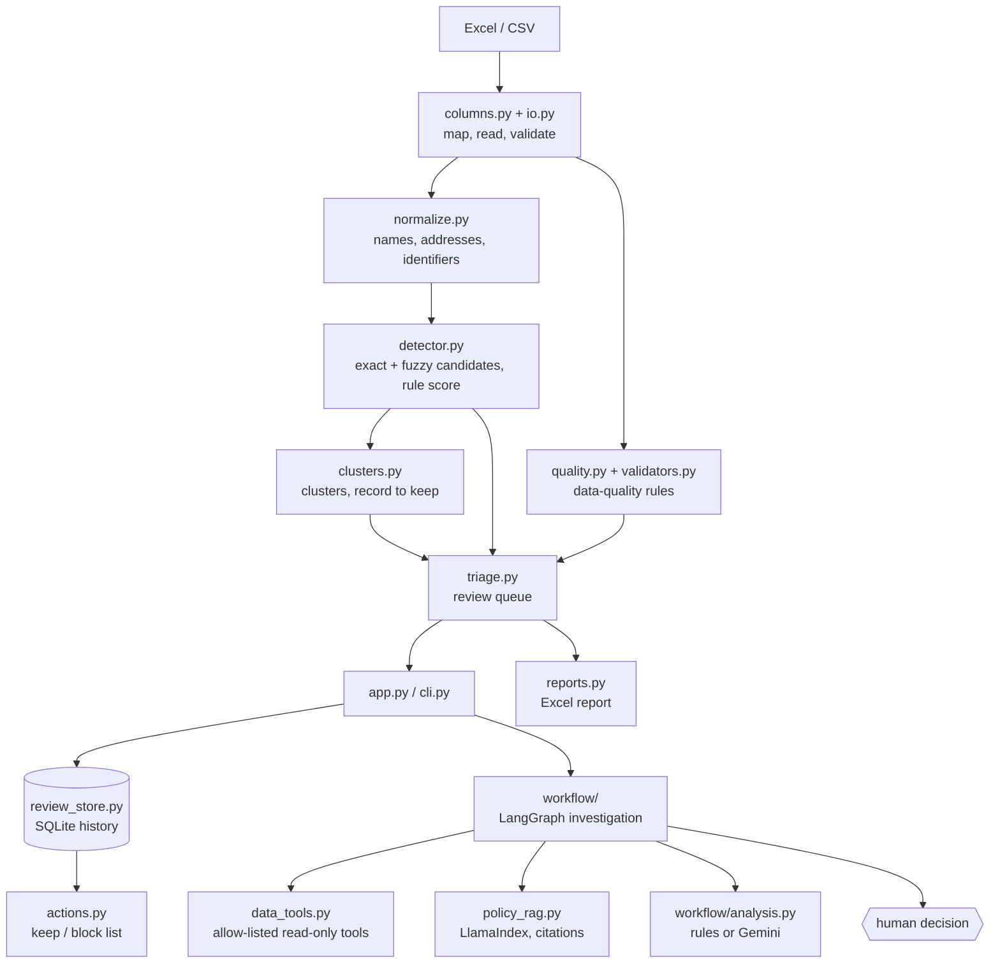

# Architecture

Supplier Integrity Desk has two layers: a **deterministic scan** that does all the
detection and scoring, and an optional **investigation agent** that gathers
evidence for one supplier and stops for a human decision. The Streamlit app and
the `supplier-desk` command are thin layers over the same Python package.



## The scan (no AI)

| Module | Responsibility |
|---|---|
| `columns.py` | Canonical schema, ERP header synonyms, mapping suggestions |
| `io.py`, `database.py` | Read Excel/CSV as text or run one read-only SQL query; choose the sheet, validate IDs, size limits |
| `normalize.py` | Lower-case, strip accents and punctuation, drop legal forms, expand address abbreviations, blank out placeholder identifiers |
| `detector.py` | Candidate pairs from shared identifiers (grouped) and similar names/addresses (RapidFuzz `cdist`, per country); transparent rule score |
| `quality.py`, `validators.py`, `taxid.py` | Rule-based findings with a code, priority, reason and suggested action; IBAN and tax / VAT number checks |
| `clusters.py` | Union-find over linked pairs; record-to-keep ranking |
| `triage.py` | One `ScanResult`: queue, pairs, findings, clusters, completeness, stable finding IDs and a dataset fingerprint |
| `compare.py` | Field-by-field match / similar / different signals |
| `actions.py`, `reports.py`, `exports.py` | Keep/block list, Excel report, formula-safe CSV |
| `changes.py` | Snapshots of a scan (finding IDs, names, salted hashes of key fields) and the differences between two scans |
| `lookup.py` | Score one not-yet-created supplier against the master with the same rules |
| `i18n.py`, `i18n_es.py` | Translator and Spanish catalogue; `TranslatedStreamlit` translates every label without touching widget values |

Finding IDs are hashes of the supplier IDs (and rule code for quality findings),
so a decision stays attached to the same finding across rescans. The dataset
fingerprint is a hash of the supplier table; a changed file gets its own history.

## The investigation agent (optional AI)

`workflow/graph.py` compiles a fixed LangGraph:

```text
get_supplier → find_candidates → check_evidence → retrieve_policy → ai_analysis → build_recommendation → human_review
```

* Nodes reach data only through `SupplierDataService` (`data_tools.py`): typed,
  read-only, bounded functions such as `find_by_tax_id(supplier_id)`. None of
  them accepts SQL, a column name or a file path, and every call is logged in
  the case record. The same functions are exposed as LangChain tools.
* `policy_rag.py` splits Markdown policies into sections and retrieves them with
  a LlamaIndex keyword index (plus local FastEmbed vectors when enabled). Every
  passage carries a citation.
* `workflow/analysis.py` writes the explanation. The default is rule-based and
  offline; Gemini is optional, receives an allow-listed payload without tax IDs,
  registration numbers or bank accounts, and falls back to the rules on failure.
* `human_review` calls LangGraph's `interrupt()`. `ui_session.py` resumes the
  same checkpoint with the steward's decision. Nothing in the graph can write to
  supplier data.

## Evaluation

`evaluation.py` is the only module that reads the `Ground_Truth` sheet. It scores
detected pairs against labelled clusters at several thresholds — see
[EVALUATION.md](EVALUATION.md).

## Extending

* **More ERP headers:** add synonyms to `FIELDS` in `columns.py`.
* **More countries' tax IDs:** add a `TaxIdRule` (regex, example, optional check-digit function) to `RULES` in `taxid.py`.
* **Another language:** copy `i18n_es.py`, translate the values, and register it in `LANGUAGES` / `CATALOGUES` in `i18n.py`. `tests/test_i18n.py` checks that placeholders are kept.
* **A new quality rule:** add it to `check_quality`, give it a code in
  `RULE_DESCRIPTIONS`, and add a test.
* **Your own policies:** point `SUPPLIER_DESK_POLICY_DIR` at a folder of Markdown
  files with one `# Title` and several `## Section` headings each.
* **Another AI provider:** implement the `AnalysisProvider` protocol in
  `workflow/analysis.py` (a `mode` attribute and an `analyze()` method).
