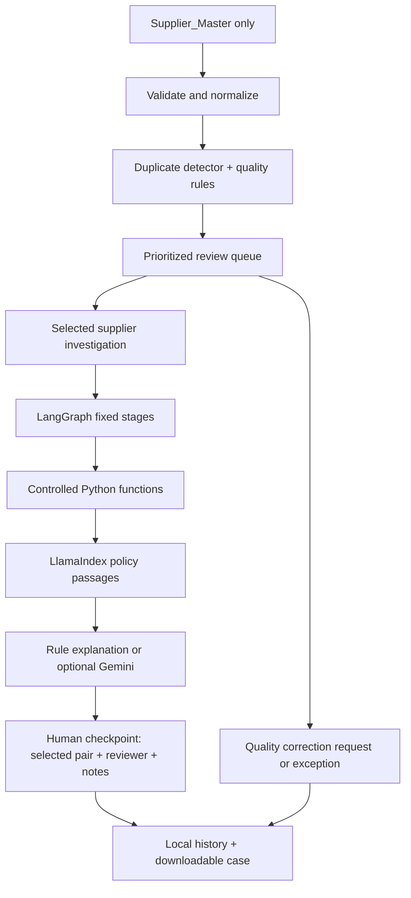

# Learn by using Supplier Integrity Desk

This folder explains how the project is built, one technology at a time. It is
written for people who want to understand controlled AI workflows (deterministic
evidence + an agent that pauses for a human) rather than only use the tool.

| Guide | Topic |
|---|---|
| [01 — LangGraph workflow](01-langgraph-workflow.md) | Fixed stages, state, interrupt and resume |
| [02 — Controlled data tools](02-controlled-data-tools.md) | Allow-listed, read-only, logged data access |
| [03 — Policy RAG](03-policy-rag.md) | LlamaIndex retrieval with citations |
| [04 — Semantic embeddings](04-semantic-embeddings.md) | Optional local vectors and hybrid retrieval |
| [05 — Streamlit interface](05-streamlit-interface.md) | How the UI drives the same graph |
| [06 — Evaluation](06-evaluation.md) | Pair-level metrics against labels, and their limits |

The guides follow the order in which the project was built ("Step 2" is the
detector, "Step 3" the LangGraph workflow, and so on). Some describe earlier
defaults; the main README describes the current version. Commands assume the
package is installed (`pip install -e ".[all]"`) and the sample workbook was
copied with `supplier-desk sample`.

## The problem before the technology

A supplier master can contain duplicates, missing identifiers or confusing
lifecycle information. A steward needs to know where to start, why a record
was flagged, and what they decided previously. This tool helps with those
tasks. It never changes source records.

Start by scanning the demo. The scan is ordinary Python, and is useful before
AI enters the picture.

## Each technology has a specific role

| Piece | Job here | Limit |
|---|---|---|
| pandas + openpyxl | Read the approved worksheet and manipulate tables | Labels stay outside investigations |
| RapidFuzz | Compare normalized names/addresses | Similar names do not prove identity |
| LangGraph | Run fixed stages and resume after an interrupt | The LLM does not choose the route |
| LangChain core | Expose typed wrappers for controlled functions | The graph calls functions directly here |
| LlamaIndex | Retrieve policy passages with citations | It does not create company policies |
| FastEmbed | Optionally reuse a pretrained local model | Semantic closeness is not a duplicate decision |
| Gemini | Optionally explain evidence | Cannot alter scores, merge records or decide |
| Streamlit | Present the queue and review actions | No separate scoring engine |
| SQLite | Keep completed local decisions | No authentication or durable graph checkpoint |

This is a controlled agent workflow, not an autonomous chatbot. The typed
LangChain wrappers are available for learning/future integration; Gemini does
not execute them in this implementation.

## Read the modules in this order

1. `columns.py` and `io.py`: column mapping, canonical IDs, validation and sheet isolation.
2. `normalize.py` and `detector.py`: comparable values and weighted evidence.
3. `quality.py`, `clusters.py` and `triage.py`: rules, clusters, priorities, stable finding IDs and fingerprints.
4. `data_tools.py`: bounded reads and logged operations.
5. `workflow/graph.py` and `nodes.py`: explicit stages, state and interrupt/resume.
6. `policy_rag.py` and `semantic.py`: keyword versus optional vector retrieval.
7. `workflow/analysis.py`: narrow Gemini payload and offline explanation.
8. `ui_session.py` and `review_store.py`: live checkpoints versus durable decisions.
9. `supplier_agent/app.py`: UI actions calling those modules.
10. `evaluation.py`: isolated labels and pair-level metrics.

## Walkthrough

1. Scan the synthetic workbook. Open a high-priority pair and inspect its
   exact-match flags; no raw identifier needs to be sent to Gemini.
2. Investigate without Gemini or embeddings. Evidence, cited fictional policy
   and human review already work.
3. Select the candidate you reviewed, add initials/reason, then decide.
   A decision about candidate B says nothing about candidate C.
4. Review a missing-identifier finding. Decide whether it needs correction
   or is a legitimate exception; not every identifier applies everywhere.
5. Restart and inspect history. Completed decisions persist; unfinished
   graph checkpoints do not. These are different kinds of persistence.
6. Enable embeddings in another case and compare the extra discovery signals.
7. Configure Gemini and repeat. The narrative can change, but Python scores
   and human authority stay fixed. A labelled fallback means Gemini failed.

## Explain it in one minute

“I built a supplier-review workflow that separates detection from AI explanation.
Python produces explainable duplicate evidence and quality findings. A queue
helps users prioritize work. LangGraph orchestrates investigations and pauses
for a candidate-specific decision. LlamaIndex retrieves cited policies; local
embeddings and Gemini are optional. Completed reviews persist locally. I tested
validation, label isolation, provider failure, human review and the UI journey.
The synthetic benchmark is a learning baseline, not proof of real-world accuracy.”

Discuss the trade-offs: heuristic scores versus calibrated probabilities;
shared accounts versus confirmed duplicates; semantic recall versus noisy
candidates; memory checkpoints versus durable ones; local history versus
authenticated enterprise auditing.

## Exercises

- Change `QualityConfig` for a fictional company's requirements and add tests.
- Add an address-only match and explain why it needs cautious review.
- Add a quality rule with a stable code, priority, reason and next action.
- Replace fictional policies with approved training documents.
- Introduce labelled hard negatives and measure precision/recall again.
- Later, replace Excel reads with approved database reads without giving the
  LLM arbitrary SQL access.

The last two original steps remain an approved-data pilot and later deployment.
